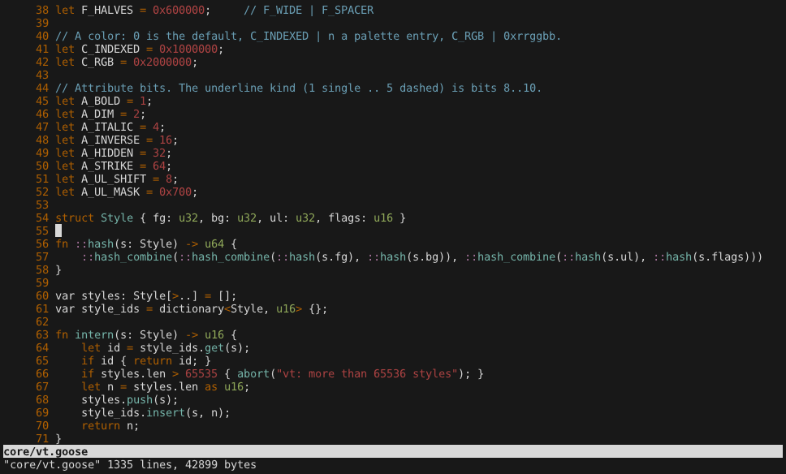
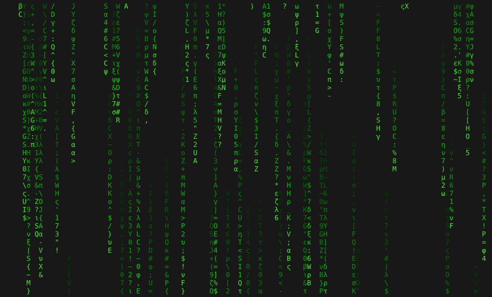

# goose-term

A headless terminal core written in [Goose](https://github.com/aardappel/goose):
a VT parser, the screen grids and a scrollback. It is benchmarked against the
terminal cores of alacritty (Rust) and Neovim (libvterm, C) on recorded
terminal output, in the style of
[goose-evaluations](https://github.com/calpeyser/goose-evaluations), with
inputs taken from [vtebench](https://github.com/alacritty/vtebench) and
[terminal-benchmark](https://github.com/vizenc/terminal-benchmark).

It also has a terminal window around the core, [gterm](#gterm-the-window).

## Results

On an i7-1355U, pinned to one P-core, the median of 5 runs, whole-process
wall time (read the input, feed it, dump, exit). See [machine.md](machine.md).

| input | MB | alacritty_terminal 0.26 | libvterm 0.3.3 | Goose |
|---|---:|---:|---:|---:|
| doomfire | 29.6 | 137 ms | 193 ms | 139 ms |
| gitlog | 20.3 | 266 ms | 2520 ms | **108 ms** |
| shakespeare | 11.2 | 195 ms | 2484 ms | **70 ms** |
| vtebench_cursor_motion | 18.1 | 83 ms | 110 ms | **72 ms** |
| vtebench_dense_cells | 19.1 | **86 ms** | 101 ms † | 94 ms |
| vtebench_light_cells | 16.9 | 86 ms | 248 ms | **16 ms** |
| vtebench_medium_cells | 16.8 | 106 ms | 270 ms | **66 ms** |
| vtebench_scrolling | 16.8 | **170 ms** | 31518 ms | 215 ms |
| vtebench_scrolling_bottom_region | 16.8 | **121 ms** | 23166 ms | 149 ms |
| vtebench_scrolling_bottom_small_region | 16.8 | 299 ms | 12248 ms | **140 ms** |
| vtebench_scrolling_fullscreen | 16.8 | 195 ms | 1462 ms | **67 ms** |
| vtebench_scrolling_top_region | 16.8 | 460 ms | 22985 ms | **147 ms** |
| vtebench_scrolling_top_small_region | 16.8 | 279 ms | 13383 ms | **138 ms** |
| vtebench_sync_medium_cells | 16.9 | 113 ms | 267 ms | **67 ms** |
| vtebench_unicode | 16.9 | **87 ms** | 430 ms † | 93 ms |

† the final screen differs from alacritty's (see [Conformance](#conformance)).
The max-min spread of the 5 runs is under 10% of the median for every cell,
and 0-4% for Goose.

| Geometric mean | Goose speed | Goose peak memory |
|---|---:|---:|
| vs alacritty_terminal (15 inputs) | 1.69x faster | 1.25x less |
| vs libvterm (13 inputs where it agrees) | 22.1x faster | 1.40x less |

Every row reads its whole input into memory first, so about 17-30 MB of
every peak is the input itself. The memory gap is the scrollback. alacritty
keeps 10000 full-width rows of 24-byte cells and libvterm's Neovim-style
ring keeps 10000 full-width rows of 40-byte cells. Goose keeps 6-byte cells
with trailing blanks trimmed, so shakespeare peaks at 17.0 MB vs 53.7 MB
and 79.7 MB. Full tables, including memory per input, are in
[results/RESULTS.md](results/RESULTS.md); raw data is in
[results/bench.json](results/bench.json).

### Where Goose is slower

- **vtebench_scrolling and scrolling_bottom_region** (`y\r\n` over and
  over) cost about 570 instructions per line in Goose. The time goes to
  dispatching a one-byte text run and two control characters, rotating 39
  row numbers, and pushing a line into the scrollback. alacritty's grid is
  a ring buffer, so a full-screen scroll is an offset change.
- **dense_cells** and **unicode**: within 10% of alacritty. Each cell
  changes the pen, which in Goose is a style-table lookup.
- **doomfire**: a tie. Every cell is a two-SGR, one-character write.

### What made the scroll paths fast

The first version took 1.0 s on vtebench_scrolling, 5x alacritty. A
callgrind profile showed two costs, both fixed:

- Copying a line into the scrollback scanned all 174 cells backwards for
  the last non-blank. Each physical row now keeps an upper bound (`used`)
  of where its content ends, which the hot writers raise as they write.
- Clearing a new row wrote 174 cells one by one. Cells past `used` are
  already blank, so a reset now clears only `[0, used)`.

## gterm, the window



`gui/gterm.goose` (about 950 lines) is a terminal emulator built on the core
and Goose's `gfx` package (SDL3's GPU API):

- **Shell:** your shell runs on a pty (`gui/pty.c`, `forkpty`).
- **Drawing:** every frame draws the screen as one instanced quad per
  cell. The fragment shader blends the cell's glyph over its background.
  Glyphs come from a monospace TrueType font that `ui` (Nuklear's
  stb_truetype) bakes into an atlas: DejaVu Sans Mono or Liberation Mono,
  with bold.
- **Box drawing and blocks** (U+2500-U+259F) are drawn as rectangles
  rather than glyphs, so lines join from cell to cell. The table of their
  arms is generated from the Unicode names (`gui/gen_box.py`).
- **Colors and text:** 256 colors and truecolor; bold, dim, underline,
  strikeout, reverse and hidden; the block, underline and bar cursors.
- **Keys:** keys are sent as xterm sends them: application cursor mode,
  modifier forms like `ESC[1;5D`, function keys, Ctrl and Alt combinations.
- **Mouse and scrolling:** mouse reporting (1000/1002/1003, SGR 1006),
  focus events, bracketed paste and the window title. The wheel scrolls
  the scrollback, or sends arrow keys on the alternate screen.
- **Resizing** keeps each row's cells from the left. Rows are not
  reflowed.

Its own keys: Shift+PageUp/PageDown/Home/End scroll back; drag with the
left button to select, then Ctrl+Shift+C copies; Ctrl+Shift+V or
Shift+Insert pastes; Ctrl+= / Ctrl+- / Ctrl+0 change the font size.

```bash
bin/build-gui        # after bin/build-all; fetches and builds the gfx package once
.out/bin/gterm [--font FILE.ttf] [--size PX] [--shell PATH]
```

The core's interactive parts (replies to DSR and DA, OSC titles, mouse
modes, resize) are tested by `tests/interactive.goose`. They leave the
screen as it was, so the benchmark rows still agree, at the same speed.
`gterm --type TEXT --keys K,K --seconds N --shot FILE.png`, run with
`GOOSE_GFX_HEADLESS=1`, drives the window without a display. That is how
the screenshot above was made.

`examples/matrix/` is a Goose program to run in it: the Matrix's digital
rain in 24-bit color. It writes only the cells whose shade changed each
frame and quits on any key. `bin/build-gui` builds it as
`.out/bin/matrix`. Its `--kana` option rains half-width katakana, as in
the film, for a font that has them.



Not there yet:
- no reflow on resize;
- no italic font;
- no font fallback for CJK and emoji, which show as `?`;
- zero-width marks are not drawn;
- idle, it still wakes 60 times a second for window events, which costs
  about 4% of a core.

## gterm against other terminals

`bin/run-gui` runs vizenc/terminal-benchmark's three tests in real
windows, with gterm and the terminal emulators installed here: alacritty
0.17.0, Ghostty 1.3.1 and xfce4-terminal 1.2.0 (X11, Intel Iris Xe). Each
window is 174x39 cells of DejaVu Sans Mono 12 pt, started with no user
configuration. The terminals take turns, 5 runs each; the medians are
below, and every run is in [results/GUI.md](results/GUI.md).

| terminal | `cat` 11 MB, ms | DOOM-fire, fps | idle RSS, MB | RSS after `cat`, MB | idle CPU |
|---|---:|---:|---:|---:|---:|
| gterm | **122** | 1167 | **42.5** | **47.0** | 4.0% |
| alacritty | 196 | **1185** | 73.1 | 113.7 | **0.0%** |
| Ghostty | 257 | 594 | 149.3 | 160.7 | 0.3% |
| xfce4-terminal | 297 | 672 | 60.1 | 62.3 | **0.0%** |

- **`cat`** is the time `cat shakespeare.txt` takes inside the terminal,
  as timed by the shell around it. It is how fast the terminal reads its
  pty, not when the text is all on the screen.
- **DOOM-fire** is `examples/doomfire`, a Goose port of DOOM-fire-zig
  that writes the same frames. Its frame rate is how fast the terminal
  takes the frames in. On a bare pty, with nothing drawing, it makes
  about 2460 fps, so here the terminals are the limit.
- **Memory** is the terminal process's VmRSS: 5 s after start, and after
  the same `cat`. It counts shared libraries and not GPU memory. The
  scrollback each keeps differs: 10000 lines for gterm and alacritty,
  Ghostty's default byte limit, xfce4-terminal's 1000 lines.
- **Input latency**, terminal-benchmark's fourth test, is not measured:
  it needs a camera filming the screen.

## The rows

| row | what it is | source |
|---|---|---|
| alacritty | `alacritty_terminal::Term` behind `vte::ansi::Processor`, alacritty's release profile | [baselines/alacritty_row](baselines/alacritty_row/src/main.rs) |
| libvterm | `VTermScreen` with a Neovim-style scrollback ring, `gcc -O2` | [baselines/libvterm_row.c](baselines/libvterm_row.c) |
| Goose | `core/vt.goose`, about 1200 lines, `goose build -O2 --cc gcc` | [core/vt.goose](core/vt.goose), [core/vt_row.goose](core/vt_row.goose) |

All three feed the input in 64 KiB chunks and print the same canonical dump
([tests/DUMP.md](tests/DUMP.md)): FNV-1a hashes of the text and attributes
of every scrollback line and screen row, plus the cursor. A timing only
counts if the row produced the same screen.

The Goose core reproduces alacritty_terminal 0.26 and vte 0.15 rule for rule,
quirks included:

- vte's UTF-8 error recovery, including the characters it drops at a chunk
  boundary;
- alacritty's history rules for `ED 2` and scroll regions;
- its wide-character fixups and its `DCH`/`ICH` swap order.

## Inputs

`bin/fetch-inputs` makes all 15 inputs and checks them against
[inputs/sha256.txt](inputs/sha256.txt):

- **vtebench_\*** (12 inputs): each vtebench benchmark script run once
  under a 174x39 pty with `TERM=xterm-256color`, the run repeated to at
  least 16 MiB ([inputs/capture.py](inputs/capture.py)).
- **shakespeare**: terminal-benchmark's `cat` test file.
- **doomfire**: 250 frames of DOOM-fire-zig's output at 174x39, as
  terminal-benchmark runs it ([inputs/doomfire.py](inputs/doomfire.py)).
- **gitlog**: `git log -p --stat --color=always` of the last 400 Goose
  commits, 20 MB of SGR-colored text.

## Conformance

`tests/cases.py` writes 68 small streams:

- one per feature: wrapping, tabs, every `ED`/`EL` variant, scroll regions,
  origin mode, SGR, the alternate screen, insert mode, DEC graphics, wide
  and zero-width characters, `REP`, bad UTF-8, string sequences, aborted
  sequences;
- 20 random byte soups.

`tests/diff.py` runs rows over them and diffs the full dumps where the
checksums differ.

- **Goose vs alacritty: 83/83 agree** (68 cases and 15 inputs). They also
  agree with the input fed 1, 2, 3, 5, 7 and 64 bytes at a time.
- **libvterm vs alacritty: 13/15 inputs and 32/68 cases agree.**
  - Most case differences are real semantic differences that the cases
    were written to probe, such as what `ED 2` does to the scrollback,
    `REP`, origin-mode motion and tab handling. libvterm also has no dim.
  - dense_cells and unicode differ by attributes and character widths.
  - 8 cases crash libvterm 0.3.3:
    - **heap overflow:** a CSI with more than 16 parameters writes past
      `args[CSI_ARGS_MAX]` (`src/parser.c:235`);
    - **NULL dereference:** `REP` of a wide character at the end of a row
      (`src/screen.c:190`, through `src/state.c:1238`).

    None of the 15 inputs triggers either crash.

## Running it

```bash
bin/fetch-inputs     # vtebench, terminal-benchmark, the 15 inputs (about 255 MB)
bin/build-all        # goose @ 1e31b6d, libvterm @ v0.3.3, the three rows
bin/run-all          # conformance, then 5 timed runs: results/
bin/build-gui        # gterm, matrix and doomfire
bin/run-gui          # the GUI tests, in windows on the display: results/GUI.md
```

Needs git, cmake, gcc, cargo, python3 and perl. libvterm needs about
2.5 minutes per round on the scrolling inputs.

## Layout

- `core/`: the Goose terminal core, its benchmark harness, and the width
  table (`width.bin`, generated from unicode-width 0.2.2 by `gen_width.py`).
- `gui/`: gterm, its pty layer in C, and the box drawing table.
- `examples/matrix/`: digital rain, a Goose program for the terminal.
- `examples/doomfire/`: the DOOM-fire frame-rate test, in Goose.
- `baselines/`: the alacritty and libvterm rows.
- `inputs/`: input generators and checksums.
- `tests/`: conformance cases, the diff tool and the dump spec.
- `scripts/`: the benchmark runners (CLI and GUI) and their table scripts.
- `bin/`: the scripts to fetch, build and run.

Third-party code and licenses are listed in [THIRD_PARTY.md](THIRD_PARTY.md).

## License

Apache-2.0 ([LICENSE](LICENSE)), except `inputs/doomfire.py` and
`examples/doomfire/doomfire.goose`, which follow DOOM-fire-zig and are
GPL-3.0-or-later (see [THIRD_PARTY.md](THIRD_PARTY.md)).
